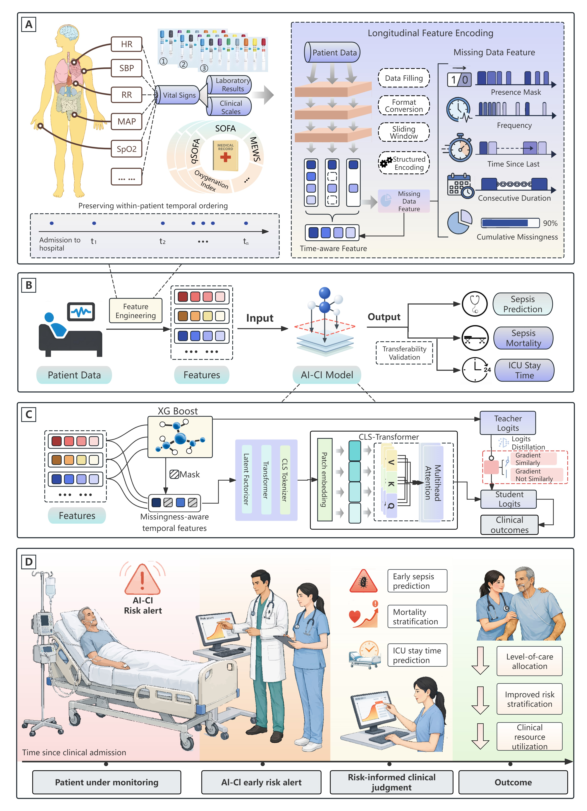

# AICI: A Process-Aware AI System for Critical Care Outcome Prediction

AICI (Artificial Intelligence for Critical Illness) combines physiological measurements with missing data features (MDF) to represent clinical monitoring processes through temporal patterns of data availability. It supports prediction of sepsis onset, in-hospital mortality among patients with sepsis, and ICU stays of at least 24 hours following oral cancer surgery. The study evaluated the system across five intensive care cohorts, with findings supporting the inclusion of data-availability patterns alongside physiological information to improve critical care outcome prediction. Further evaluation is needed to determine whether model-guided care improves clinical decisions and patient outcomes.

This repository provides implementations of feature engineering, XGBoost teacher training, LF-Transformer student distillation, prediction and evaluation, and six comparator models.

Related paper: *A process-aware foundation AI system enables robust prediction of sepsis and critical care outcome*.

Code repository: [AICI](https://github.com/dudechess745-beep/AICI).

## Overview



Figure: Figure 3 from the paper, showing clinical data inputs, longitudinal feature and missingness encoding, prediction tasks, teacher–student distillation, and a proposed clinical workflow. The clinical application component is conceptual.

The pipeline constructs raw measurement features, window statistics, clinical scores, and missing data features; trains an XGBoost teacher and selects student inputs using feature importance; builds LF-Transformer representations through column and row attention; controls the distillation signal using gradient cosine similarity; and produces predictions using the student model alone.

## Repository Structure

| Path | Purpose |
|---|---|
| `aici/` | Data preparation, training, prediction, evaluation, and shared utilities |
| `C1_sepsis_onset_prediction/` | Feature engineering, models, and execution entry points for C1 sepsis onset prediction |
| `C2_sepsis_onset_prediction/` | Feature engineering, models, and execution entry points for C2 sepsis onset prediction |
| `C3_in_hospital_mortality_prediction/` | Feature engineering, models, and execution entry points for in-hospital mortality prediction |
| `C4_prolonged_ICU_stay_prediction/` | Feature engineering, models, and execution entry points for prediction of total ICU stays ≥24 hours |
| `configs/` | Cohort training parameters, input variables, and comparator configurations |
| `sql/` | MIMIC-IV data extraction and preprocessing SQL |
| `baselines/` | Six comparators: Random Forest, XGBoost, TabNet, LSTM, GRU, and LF-Transformer |
| `assets/` | Workflow figure used in this README |
| `third_party/` | Licenses and copyright notices for third-party code |

The four task directories use consistent entry-point names:

| File | Function |
|---|---|
| `feature_engineering.py` | Construct clinical and missing data features |
| `prepare_datasets.py` | Prepare feature arrays and labels |
| `xgb_model_train.py` | Train the XGBoost teacher and define candidate hyperparameter values |
| `distill_model_train.py` | Distill the student using the trained teacher |
| `model_predict.py` | Load trained models and generate predictions |

## Installation

Python 3.11 or later is recommended. `requirements.txt` lists the dependencies to install.

```bash
python -m pip install -r requirements.txt
```

## Data Access

The public datasets used for C1 and C2 are available from **PhysioNet**. Raw data are not included in this repository.

| Cohort | Dataset | Access |
|---|---|---|
| C1 | PhysioNet/Computing in Cardiology Challenge 2019 | [Dataset page](https://physionet.org/content/challenge-2019/1.0.0/) |
| C2 | MIMIC-IV 2.0 | [Dataset page](https://physionet.org/content/mimiciv/2.0/) |

Obtain and use the data in accordance with the requirements on each dataset page. MIMIC-IV requires the platform's access credentialing and data use agreement.

## Input Data and Configuration

Prepare the input data and data splits according to the task requirements. Data can be stored in `aici/data/`. `configs/C1_schema.json` through `configs/C4_schema.json` define input variables and their groups, while `configs/C1.json` through `configs/C4.json` specify training parameters and computing devices. Teacher hyperparameter candidates are defined in each task's `xgb_model_train.py`; comparator settings are provided in `configs/baselines.json`. See the [SQL instructions](sql/README.md) for C2 extraction requirements.

## Training and Prediction

Run the workflow from the repository root in the order “data preparation → teacher training → student distillation → prediction and evaluation.” Use `prepare_datasets.py`, `xgb_model_train.py`, `distill_model_train.py`, and `model_predict.py` in the corresponding task directory, specifying data, configuration, and output paths through command-line arguments. Model weights can be stored in `aici/weight/`. The teacher remains fixed during distillation, and only the student is used for prediction. Run evaluation through `python -m aici.evaluation evaluate`. Each entry point supports `--help`; input variables and their order must match those used during training.

## Comparator Models

All six comparators support `train`, `predict`, and `evaluate`, share the same prepared data outputs, and are run through their respective model files in `baselines/`. The standalone LF-Transformer uses supervised training without knowledge distillation. LSTM and GRU organize recurrent inputs by engineered feature groups.

## Third-Party Code

Licenses and copyright notices for third-party code are retained in `third_party/`.
